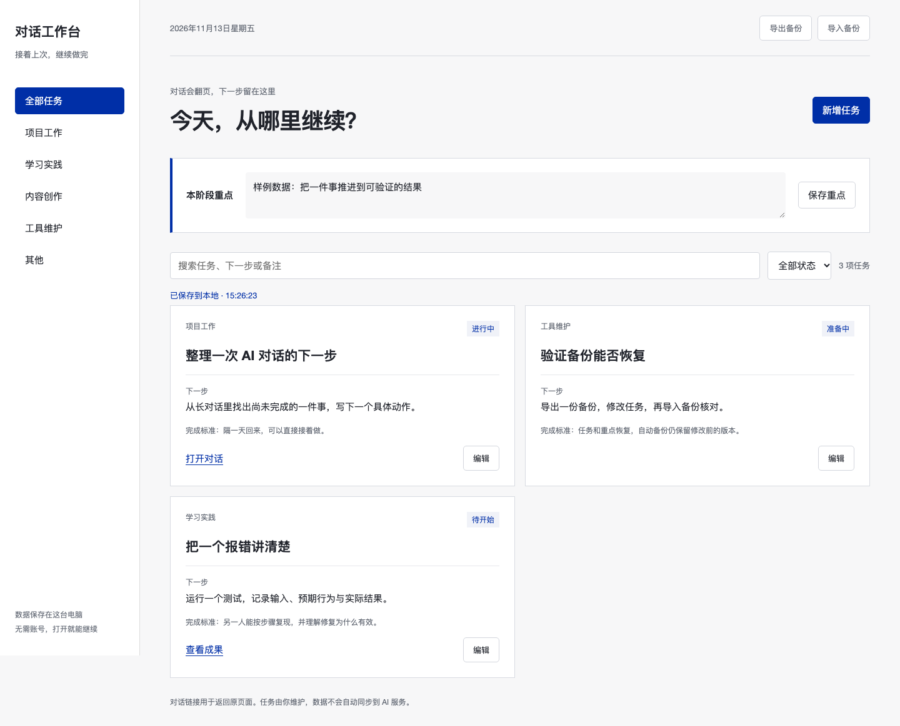

# 对话工作台 · Chat Workbench

把 AI 对话里的任务、下一步和成果入口留在本机。

当你同时使用几个 AI 对话，隔一天回来，可能还记得聊过什么，却忘了事情推进到哪里。对话工作台提供一个本地页面：一张卡片对应一件事，记录原对话、下一步、完成标准和成果链接。

**状态：v0.1.0-alpha.1，早期试用版。** 目前界面为中文。[English introduction](README.en.md)

截图中的任务为合成样例。

## 启动

需要 Python 3.10 或更新版本，以及支持 dialog、structuredClone 和 crypto.randomUUID 的近期浏览器。无第三方运行依赖，无安装或构建步骤。

下载源码并解压后，在目录中运行；也可先通过 Git 获取：

~~~bash
git clone https://github.com/andy2025AI/chat-workbench.git
cd chat-workbench
~~~

启动工作台：

~~~bash
python3 server.py --open
~~~

Windows 可使用：

~~~powershell
py -3 server.py --open
~~~

浏览器打开 http://127.0.0.1:8765 。保持终端窗口运行，按 Ctrl+C 停止服务。请通过这个服务地址使用；直接打开 index.html 无法读取或保存数据。

已在 macOS 的 Python 3.11.15 与 3.13.2 环境验证。Windows 操作尚待实机验证。

macOS 也可双击 start.command；如果系统阻止打开，请使用上面的终端命令。

若端口被占用：

~~~bash
python3 server.py --port 8766 --open
~~~

## 第一个任务

1. 点击“新增任务”，填写一件正在做的事。
2. 写下一个具体的“下一步”，以及怎样判断它完成。
3. 可选：粘贴原对话和成果的完整 http/https 链接。
4. 保存任务。需要继续时，按分类、状态或文字搜索找到它。

新工作台从零任务开始。想先看效果，可通过“导入备份”导入 [合成样例](examples/workspace.json)；导入会替换当前工作台，并在写入前备份旧版本。

本阶段重点使用“保存重点”单独保存。导出备份也会包含重点输入框中尚未保存的文字；正在编辑的任务应先保存再导出。

## 数据、备份与恢复

- 当前数据：data/workspace.json。
- 每次成功保存前，旧快照复制到 data/backups/，文件名使用 UTC 时间。
- 通过“导出备份”下载 JSON；通过“导入备份”恢复某份导出文件或自动备份。
- 导入先校验备份的版本号，再使用当前工作台的版本号进行冲突检查。
- 数据文件、自动备份与导出均采用紧凑 JSON，使接近大小上限的有效备份仍可导入。
- 备份不会自动清理。请定期复制重要备份到你自己管理的位置。

可以指定独立的数据目录：

~~~bash
WORKBENCH_DATA=/path/to/my-workbench-data python3 server.py --open
~~~

PowerShell：

~~~powershell
$env:WORKBENCH_DATA = "C:\workbench-data"
py -3 server.py --open
~~~

旧个人版的分类不同，本版不会读取或自动迁移旧数据。

## 两个页面同时编辑

每次成功保存都会递增 revision。旧页面尝试保存时，服务器返回 HTTP 409，保留已经写入的版本。

遇到冲突，可关闭编辑框后导出备份：文件名含 draft，包含最近一次保存失败时的任务草稿和当前重点。随后刷新查看最新版本并人工合并。保存失败后又继续输入的内容，应再次尝试保存，或自行复制保留。

数据目录具有进程独占锁；第二个服务使用同一目录时会明确拒绝启动。停止原服务或指定另一个 WORKBENCH_DATA 即可。

## 使用边界

服务仅监听 127.0.0.1，面向同一台电脑上的单人使用。原对话仍由相应服务提供，打开链接可能需要在那里登录。此工具不读取聊天正文、不调用 AI、不自动同步任务。

数据和备份以未加密 JSON 保存。本机其他程序及账户保护仍由操作系统负责。本工具不提供公网部署或多用户权限控制。

任务标题上限 200 字符，重点 5000 字符，单个其余文字字段 10000 字符，最多 2000 项任务；请求和导入文件上限为 5,000,000 字节。

## 验证与贡献

运行 HTTP 集成测试，测试数据只写入临时目录：

~~~bash
python3 -m unittest -v test_server.py
~~~

如果已安装 Node.js，也可检查前端语法：

~~~bash
node --check app.js
~~~

[贡献说明](CONTRIBUTING.md) · [代码练习：为什么要返回 409](docs/learning-01.md)

本项目由个人工作台整理而来，开发与文档使用了 AI 辅助。当前没有独立使用人数、效率提升或客户效果的验证数据。

## 许可证

[MIT License](LICENSE)。
